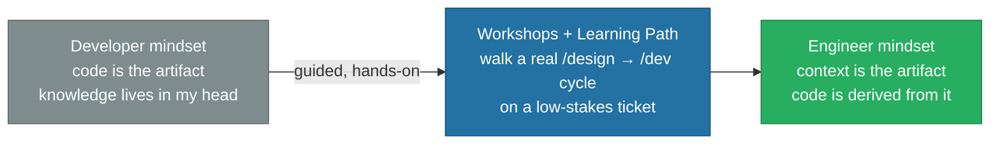

# The Mental Model Shift

> **Code used to be the artifact. Now the context is.**

Every challenge in [The Challenges](./03%20Challenges.md) assumes the harness gets used as designed. It only does if the people running it actually adopt the mental model behind it. For most developers, code has always been the deliverable — the thing reviewed, merged, and shipped. The harness inverts that: the HLD, the conventions, and the accumulated context are the deliverable, and code is what falls out of them once the AI executes against a scoped ticket. That is not a new IDE shortcut to pick up. It is a redefinition of what "doing the job well" means, and it does not land by reading a README.

| Area             | Developer mindset (before)             | Engineer mindset (after)                                                                  |
| ---------------- | -------------------------------------- | ----------------------------------------------------------------------------------------- |
| Primary artifact | Code is the artifact — review the diff | Context is the artifact — review the HLD, the diff follows                                |
| Source of truth  | "I know the codebase" lives in my head | "I know the codebase" lives in docs the AI can also read                                  |
| Docs discipline  | Skipping docs to move faster           | Skipping docs breaks the AI on the next session, not just the next hire                   |
| Success metric   | Judged on lines shipped                | Judged on direction set — architectural calls, scoped tickets, catching what the AI can't |

Without deliberate onboarding, engineers keep working the old way around the new tooling — treating `/design` and `/dev` as optional ceremony instead of how the work actually gets done — and the harness never earns the trust it needs to replace old habits.

---

## Engineer = Creative Direction. AI = Workflow and Execution.

Think of the AI assistant as a senior pair-programmer who knows the codebase conventions inside out, never forgets a checklist, and can type faster than any human — but still needs _you_ to decide what to build and why.

**The engineer owns the problem. The AI owns the execution.**

**What the engineer does:**

- **Defines the goal** — picks up the ticket, understands the business context, decides the approach
- **Makes architectural calls** — chooses patterns, resolves trade-offs, says "no" when a suggestion doesn't fit
- **Reviews every step** — the AI stops at each phase boundary; the engineer reads the output and approves or redirects
- **Catches what the AI can't** — domain nuance, product intent, "this is technically correct but wrong for us"

**What the AI does:**

- **Follows the workflow** — runs the `/dev` lifecycle (Plan → Implement → Test → Document) without skipping steps
- **Knows the conventions** — reads the skills, respects the architecture, applies project-specific rules automatically
- **Implements incrementally** — one step at a time, surfacing blockers early rather than delivering a big surprise
- **Keeps the docs honest** — updates READMEs and skills as part of the same task, not as an afterthought

| Concern             | Owner         | Reason                                                 |
| ------------------- | ------------- | ------------------------------------------------------ |
| What to build       | Engineer      | Requires business context and product judgement        |
| How to structure it | Engineer + AI | Collaborative — AI proposes, engineer decides          |
| Writing the code    | AI            | AI is fast and consistent; engineer reviews            |
| Testing             | AI + Engineer | AI runs the suite; engineer validates intent           |
| Documentation       | AI            | AI has full context of what changed; engineer approves |

The engineer is never idle. While the AI is implementing, the engineer is reading the plan, thinking ahead, spotting risks. The moment the AI pauses for confirmation, the engineer is ready with a decision — not catching up. This keeps velocity high without trading away quality or ownership.

This is the same balance told in [Humans Gate, AI Carries Context](./01%20From%20Broken%20Handoffs%20to%20Governed%20AI.md#3-humans-gate-ai-carries-context) — here at the level of one engineer's daily habit rather than the SDLC's context handoffs.

---

## How to Address This

A short workshop series and learning path makes the shift real. Naming the target mental model isn't internalizing it — walking the team through a real `/design` → `/dev` cycle on a low-stakes ticket is what makes the phase boundaries and review points become muscle memory, not theory.

> From Typing Code to Directing It

---

Once the mindset holds, the mechanics that make it repeatable — which context layer feeds which phase, and what each phase is required to leave behind — are in [Target Agentic SDLC Setup](./05%20Target%20Agentic%20SDLC%20Setup.md).
